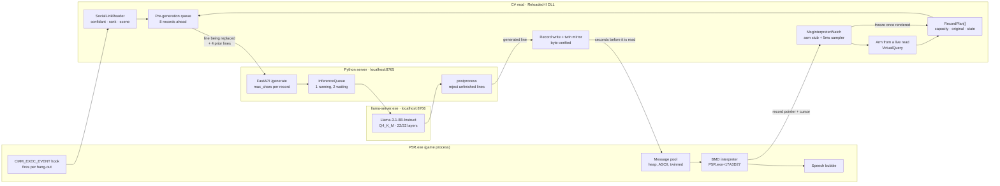
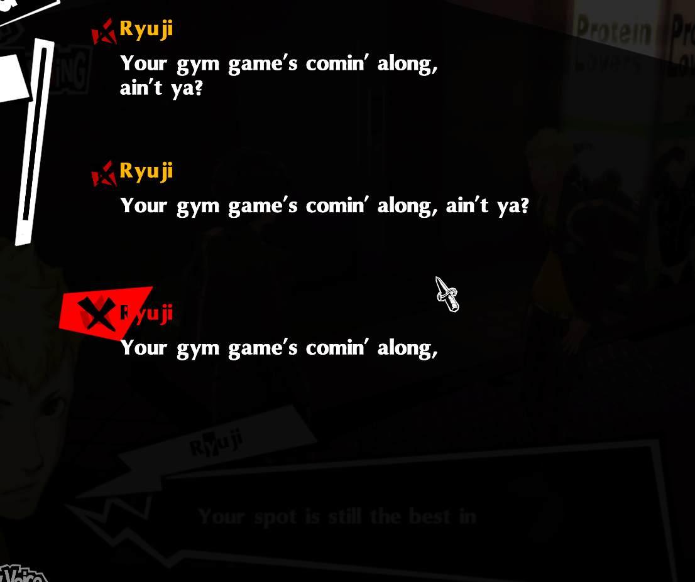
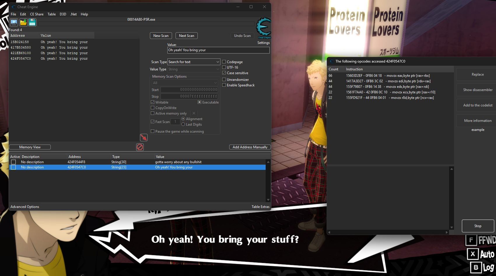

# P5R Generative Social Links

> *What if Ryuji actually remembered what happened last time you hung out?*

A [Reloaded-II](https://reloaded-project.github.io/Reloaded-II/) mod that replaces Persona 5 Royal's scripted Social Link dialogue with live AI generation — running entirely on your local GPU. No cloud, no API keys, no internet. Every conversation is unique.

[](https://github.com/SrijanSuresh/p5r-gen-social-links/actions/workflows/ci.yml)


---

## For people who haven't touched a compiler

Persona 5 Royal has 22 Social Link characters — Ryuji, Ann, Makoto, and so on. Every line they say is pre-written, fixed forever in the game's script. This mod hooks into the game's memory while it's running, reads who you're hanging out with and how close you are, sends that to a small AI model running on your own PC, and gets back a reply that sounds like that character at that moment in your relationship.

**Ryuji at Rank 4, gym hang-out — real Llama-3.1-8B output, generated locally:**
> *"Yo, Joker, finally getting some actual exercise for once, huh? You gotta step up your game if we wanna take down those corrupt hearts!"*

> *"Dude, we gotta keep movin'! You're slippin', Joker, get those reps back up!"*

Both took under a second on an RTX 4060. It generates in his voice, at the right emotional register for where you are in the friendship, without ever leaving your machine.

---

## Architecture



Two processes over loopback HTTP. The C# mod lives inside P5R's process; the Python
server starts before the game. If the server isn't up, the mod leaves the scripted
dialogue alone and says nothing.

The cycle in the middle is the point: the interpreter's own read tells the mod where the
pool is *and* how far the player has got, and the mod writes ahead of that position.

### Component summary

| Component | Language | What it does |
|---|---|---|
| `PointerChainResolver` | C# | Walks `[moduleBase + 0x2A63EF0] → [CMM + 0x48]` to find the active session struct, VirtualQuery-guarding every dereference |
| `SocialLinkReader` | C# | Reads confidant ID, rank level, and scene number from the resolved struct |
| `AdvancePoolCursor` | C# | Turns the hook's record pointer into a position in the plan, and freezes every record at or behind it |
| `Addressee` | C# | Derives who each line is spoken to from the order the scene's speakers take their turns |
| `MsgInterpreterWatch` | C# | Five injected instructions ahead of `P5R.exe+17A3D27` copy the record pointer and cursor to a fixed slab; a 5 ms sampler turns that into a sequence |
| `RecordPlan` | C# | Per-record life cycle — Pending → InFlight → Ready → Written → Rendered — plus capacity and the scripted line being replaced |
| `Mod.Text.cs` | C# | ASCII and English-shape heuristics — no longer how the pool is *found*, still how a line is *recognised* |
| `InferencePipeline` | Python | Builds character-faithful prompts with rank-tier emotional guidance, then calls the backend |
| `LlamaServerClient` | Python | HTTP client for `llama-server`, speaking OpenAI chat-completions |
| `LlamaServerProcess` | Python | Spawns and supervises `llama-server.exe`; waits for weights, reaps on exit |
| `InferenceQueue` | Python | One inference in flight, two waiting. Dropping was right while generation was reactive; pre-generation asks for records the player has not reached, so lateness is handled on the client |
| `postprocess.py` | Python | Strips OOC commentary, name prefixes, stage directions and wrapping quotes; folds to ASCII for the game buffer; **rejects any line that cannot end on a sentence boundary**, because a severed line reads worse than the script it replaces |

---

## Project phases

### ✅ Phase 1 — Memory scaffold
Reverse-engineered the CMM session struct layout from Ghidra + live hex dumps. Established the ASLR-aware pointer chain. Confirmed confidant ID, rank, and scene number reading in-game.

### ✅ Phase 2 — LLM inference
Switched backend from auto-gptq to llama-cpp-python. Wired real Llama-3.1-8B-Instruct (Q4_K_M) inference through a FastAPI server. Confirmed end-to-end: game hang-out → C# hook → HTTP POST → GPU inference → generated dialogue logged. 54 commits, 119 automated tests.

**Confirmed working:**
- All 22 Social Link characters recognised by the inference pipeline
- Real inference latency: <2s on RTX 4060 after CUDA warmup
- Per-line trigger: the interpreter hook reports each record as it is read (it replaced an `0x006FFC28` line-counter poll found in Cheat Engine)
- CI: GitHub Actions runs Python tests, the .NET build and the .NET parser tests on every push

### ✅ Phase 3 — Dialogue write-back

#### 🏆 Milestone: a whole scene, generated ahead of the player

Every line Ryuji speaks below was written by a local Llama-3.1-8B into the game's own
message buffer, seconds before the player reached it, and drawn by P5R's renderer:


The text log shows the scene as the player experienced it — each entry a different
generated line, wrapped across the bubble's rows:



Best measured scene: **21 of 21 eligible records replaced, median 1.78 s per line, zero
dropped requests.** A trimmed log of a two-confidant session is in
[`docs/sample-session.log`](docs/sample-session.log).

#### 🏆 Milestone: the game tells us where its dialogue is

The mod no longer searches for the dialogue buffer. It reads the address out of the
instruction that consumes it.

Found with a hardware read watchpoint on a line while it was on screen. Five call sites
touched those bytes; one loads both the record pointer and the byte cursor from memory,
which makes a single hook enough:



```
P5R.exe+17A3D1F   movsxd rdx, dword ptr [rbx+30]   ; byte cursor
P5R.exe+17A3D23   mov    rax, [rbx+20]             ; message record
P5R.exe+17A3D27   movzx  edi, byte ptr [rdx+rax]   ; the character
```

Observed live with *"Oh yeah! You bring your stuff?"* in the bubble:
`RAX=0x424F054798`, `RDX=0x28`, `RDI=0x4F` — `'O'`.

| | Before | After |
|---|---|---|
| Locating the pool | scan 4030 regions, score for English | `VirtualQuery` on an address the game just read |
| Time to arm | **33 s** | microseconds |
| Memory walked | 1.4 GB | none |
| Result | a ranking, right *most* of the time | the region the game read from |

`scripts/verify-signature.py` confirms the 16-byte signature occurs **exactly once** in
the 378 MB executable — `FindPattern` returns the first hit and never mentions a second.

#### 🏆 Milestone: the BMD format, read as a format

The pool turned out to be the decompressed message archive with its symbol table intact
(`MSG_001_5_0`, `SEL 003`), not a heap of strings. Three facts came out of a hex dump and
a `[GAP]` diagnostic:

- Rows of one bubble are separated by a bare `0x0A`. Messages are separated by a control
  block — `F2 23 00 00 F1 21 F2 05 FF FF F1 41 F7`. Splitting on *gap width* would have
  worked on the measured scene by luck (12 bytes against 27); splitting on the control
  bytes is a property of the format.
- Every line is held in **two copies at a fixed offset**, learned by watching both be read
  a millisecond apart. The mirror write verifies the target byte-for-byte first, so a
  wrong offset writes nothing.
- Short runs inside a record fall below the scanner's English-sentence floor, which is
  what left `"you gotta— Wait, that ain't it!"` on screen underneath a generated line.

#### ✅ Real inference, out of process

The server previously ran in mock mode because `llama-cpp-python` was never installable
here — it is a C extension pinned to a CPython ABI, with no cp313 wheel and source-only
distribution. Inference now runs in an upstream `llama-server.exe` child process reached
over loopback HTTP, which needs no compiler, no CUDA Toolkit, and no particular Python
version. Measured: **~18 s model load, ~0.8–1.1 s per line, 0 drops.**

Two output defects surfaced only once real generations existed, and both are fixed:
Ryuji proposed to *"take down those Phantom Thieves"* — a group he co-leads — which is
now prevented by per-confidant world grounding that also keeps confidants who must not
know from mentioning them at all; and the model emitted stage directions, wrapping
quotes, and occasional non-ASCII, none of which survive an `Encoding.ASCII` write into
the game buffer.

#### 🏆 Milestone: mod-generated text rendered in-game, unaided

The mod locates the dialogue buffer on its own at runtime and writes to it. Generated text renders in Ryuji's speech bubble, drawn by the game's own renderer, with no external tooling involved:

> **Ryuji** — *"[MOCK rank 4] Dude, you're seriously the onl"*

This closes the central open question of the project. The full path is confirmed: the mod finds the pool, writes to it, and the renderer picks it up — pipeline output reaching the screen without a debugger attached.

An earlier checkpoint proved the mechanism by hand, freezing a Cheat Engine value to display `"Here we are... LLM WAS HERE!!!"`. The step above is the same result produced by the mod itself.

**What the hunt established:**

| Finding | Detail |
|---|---|
| Encoding | **ASCII**, single-byte — not UTF-16 |
| Location | **Heap** (`0x41DD7F6389`, `0x42102CAAA9`) — not the mapped BMD file region |
| Buffers | Two hold the live line; both accept writes |
| Delivery | Renderer reads the buffer **in place** — the text is never `memcpy`'d, so there is no copy to intercept |

Both facts in the first two rows were needed together, and searching either dimension alone finds nothing. Automated scans covered ASCII in the mapped-file region and UTF-16 in the heap, and so missed the text repeatedly; the address was ultimately pinned by a Cheat Engine string scan against the line visible on screen. Chapters 53–60 of `learning.md` document each wrong assumption and how it was ruled out.

**How the pool is currently located:** heap regions between `0x4100000000` and `0x4400000000` are walked via `VirtualQuery`, copied through `ReadProcessMemory` (a direct pointer walk races the game's allocator and faults fatally — see `learning.md` Ch. 61), and scored by `DialogueScore`, which weights sentence punctuation and second-person address. Every scored region is armed, not just the highest — the scene's own dialogue consistently ranked below a top-8 cutoff and was discarded before the write.

**All three of the phase's open items are closed:**

| Was open | Now |
|---|---|
| Narrow the write target | one record, chosen by index — the 211-slot write that once crashed the game is unreachable |
| Target the current line | each record gets its own generation, budgeted to its own capacity |
| Hook the accessing instruction | done, and it replaced the heap scan entirely |

### ✅ Phase 4 — Per-line contextual generation

Generation is no longer triggered by the player arriving. At arm time the mod plans the
whole scene — every record's capacity and its scripted text — and a background queue
keeps several lines ahead:

```
arm  →  plan all records  →  keep 8 ahead generating  →  write seconds early
```

This exists because reacting cannot win: inference sustains ~0.7 lines/sec and a reader
advances at up to 1.7. Pre-generating removes the race instead of trying to win it.

Each request carries **the line it is replacing** and the four before it, attributed as
the speaker's own — which is what turns separate remarks into a conversation:

> *"We came with Makoto once too."*
> *"Makoto was actually really nervous that day, remember?"*
> *"Makoto was totally sweatin', almost lost her cool in front of us."*
> *"I'm laughin' at that memory 'cause she's so uptight, dude!"*

The safety rule falls out of the hook: **a record is writable until the interpreter reads
it, and frozen afterwards.** That began as a bug — three generations landing on the record
the player was mid-read — and is now the invariant that will make typed-player-input
upgrades safe in Phase 5.

**Voice.** `speech_style` is stored separately from `personality_blurb`, because "loud,
loyal, hot-headed best friend" produced *"Guess I'm cool with paying for the session if
that's what keeps this place running."* — true to the description and nothing like the
character. Eight confidants have voices; the rest degrade to a plain register rather than
breaking. Profanity is per confidant: Ryuji swears constantly in the localisation,
Takemi does not.

Verified on two confidants through the same machinery, in one game launch:

> **Ryuji** — *"Aw, c'mon, that's basic gym etiquette, bro!"*
> **Takemi** — *"Not quite famous enough to have a decent research budget, anyway."*

### ✅ Phase 5 — Player custom dialogue *(built end to end; not yet run in-game)*

> Every other phase above is marked done on the strength of a measured scene. This one is
> not: the channel, the record reopening and the HTTP layer are all built and tested — 104
> C# tests, 343 Python tests, and a console harness that drives the real client against the
> real server — but P5R has not been launched against it. What that leaves unverified is
> the timing, which is the only part that cannot be tested without a player: whether the
> reply actually lands before the bubble advances. The `[PLAYER]` log lines are there to
> answer exactly that on the first run.


Text input, so the player writes their own line and the NPC answers it.

**The channel is a page the server already serves.** Of the three options, this is the one
that costs almost nothing, because every piece of it exists: the server is already running,
already on loopback, already a hard dependency, and already the thing that builds prompts.
A browser already solves text entry, IME composition, clipboard and font rendering — all of
which an in-game field would have to implement before a single line could be typed. The
Reloaded console is nearly free and nearly useless: a separate window to alt-tab to, and
not guaranteed to be attached at all.

```
browser  --POST /say-->  server holds one line  --GET /player-line-->  mod
```

Open `http://127.0.0.1:8765/` next to the game and type. The store holds **one** line — if
you type twice before it is collected, the second is the one you meant — and it **expires
after two minutes**, so a line typed and abandoned does not surface in a scene half an hour
later. The typed line reaches the model in the prompt's user half, beside the addressee:

```
[Scene context: ...]
[You are speaking to Joker.]
[Joker just said to you: "So... how have you been, really?"]
[Aim for about 51 characters, roughly 10 words. ...]
Ryuji Sakamoto:
```

**The server never decides which record answers it.** `/generate` runs several records
ahead of the player, so a request that silently grabbed the pending line would have the
confidant reply several bubbles too late — worse than not having the feature. So `/say`
holds, `GET /player-line` peeks, `?consume=true` collects, and the caller chooses.

**The mod takes a record back.** A player who stops to type for ten seconds is a player
whose entire eight-record lookahead has just finished generating — including the record
they are about to read. So the reply cannot go to a fresh record; it has to go to one the
queue has already filled.

```
poll (peek)  ->  pick target  ->  collect  ->  generate  ->  write
every ~2s        first unread     consume      player_line   before the
                 writable record  the line     in the prompt player advances
```

Which is safe for a reason that predates the feature. Ch. 72's invariant —

> a record is writable until the interpreter reads it, and frozen afterwards

— already says everything at or after `_poolNextRecord[0]` is fair game. The target is the
first record there that is still writable and big enough to hold a sentence, and
**deliberately not the first `Pending` one**: the record that needs reopening is usually
`Written`, holding a line generated before the player typed.

**Peek, pick, then collect — in that order.** Collecting first and then looking for a
record loses lines: if nothing writable remains ahead, the line is already out of the store
with nowhere to go. So the mod peeks on a cadence and only the request that will actually
use a line consumes it. The collection can still come back empty — the line expired, or
something else took it — and the record is handed back to the ordinary queue rather than
left `InFlight` for the rest of the scene.

**The typed line jumps the queue** inside the pump, so a tick that could serve either does
this one. It still waits for any in-flight request, up to about two seconds; cancelling
that would mean plumbing a `CancellationTokenSource` onto the plan for a saving nobody who
just spent ten seconds typing is going to notice.

**One race remains, and it is now audible.** If the player advances past the target during
generation, `FlushReadyRecords` refuses to write behind the cursor — safe, and previously
silent. A discarded pre-generated line is routine; a discarded *reply to something the
player typed* is the feature not working, and the two take the same code path. They now log
differently:

```
[PLAYER] reopening #12 (holding "Yeah, it was a sweet gym") to answer a typed line
[PLAYER] #12 answering: "So... how have you been, really?"
[PLAYER] #12 reply ready (47/60): "Honestly? Been better. But this helps, man."
[PLAYER] #12 written, 1 ahead of the player
```

Two smaller things fell out of writing it. The per-record context said *"say something with
the same purpose"* as the scripted line, which argues directly against the rule that a typed
line outranks it — a model given two conflicting instructions follows the nearer one, and
the context is nearer. And a reply addresses **Joker**, not whatever the turn model computed
for that record: that is not an override of the addressee rule but an application of it,
since the player just became the most recent speaker.

### ✅ Speaker attribution
A rank-up scene is not one person talking. Takemi's involves a patient and her father, and
every one of their lines used to be rewritten in Takemi's voice, because the only thing the
mod knew about a record was that it was a record.

The mod now parses the scene's MSG1 archive: the dialogue table locates every message, each
message header carries a speaker id, and the speaker table resolves it to a name. Records
belonging to anyone else are left alone, and — more useful — handed to the model as the
other half of the conversation, so a generated line replies to the question that was
actually asked.

Measured on Takemi's clinic scene:

```
[SPEAKER] MSG1 at 0x424D59ACB0: 48 messages, 3 speakers, dialogue ends at file+0x2180
[SPEAKER]   [0] Takemi
[SPEAKER]   [1] Girl's Father
[SPEAKER]   [2] Sick Girl
[SPEAKER] Tae Takemi: 37 own, 20 other, 7 unattributed
[SCENE] replaced 29/31 records (93%), 27 left to other speakers
```

Getting there cost two wrong guesses about the format, both recorded in `learning.md`
Ch. 75–80. The rule that finally worked: **every stored address in a BMD is relative to the
position of the field that stores it.** Nothing in the documentation says so; one hex dump
did.

### ✅ Addressee modelling

Attribution said who was talking. The prompt still assumed the listener was always Joker, in
the plainest possible way — all three world-grounding strings contained the words *"Joker —
the person you are talking to"*. So Takemi told a sick child's father about "your parents",
and answered "can I go to school tomorrow?" with a line pitched at the high-school boy
standing silently in the corner.

The BMD cannot help here. `MessageDialog` is a name, a page count, a speaker id and a page
table — there is no addressee field, and there could not be one: the renderer draws the
speaker's name above the bubble and never draws the listener, so it was never stored. A
format holds what its consumer reads. After eighty chapters of *stop inferring what the game
can hand you*, this is the case where the game genuinely never knew.

What the archive does give us is every speaker in script order for the whole scene. That is
enough for a turn model, and one rule covers it:

> **The addressee of a line is the most recent earlier speaker who is not the line's own
> speaker — and the protagonist when there is none.**

The three cases it was written from all fall out of that single rule:

| Scene shape | Walk back finds | Addressee |
|---|---|---|
| The father asks, Takemi answers | a different speaker | **Girl's Father** |
| Takemi runs three bubbles long | only herself, then the father | **Girl's Father** (carried) |
| Ryuji, 21 records, alone at the gym | nobody else, ever | **Joker** |
| The player picks a reply, then Takemi speaks | a `SEL` record | **Joker** |

That last row is the one the format pays for twice. A selection is the only place the
protagonist speaks — he is silent by design — so the addressee set is the speaker table
*plus* him, and `SEL` counts as his turn.

**Where the fact goes matters as much as what it is.** The obvious home for an addressee is
the system prompt, next to the character notes, and that would be a measurable mistake:
llama-server reuses the KV cache for the longest identical prefix between requests, the
system prompt *is* that prefix, and baking a per-line value into it took generation from
~1.5 s to ~3.5 s when `max_chars` tried it (Ch. 72). So the two facts that had been welded
into one string got prised apart — what Joker permanently is in this world stays in the
cached half, and who happens to be listening moves to the user half beside the length rule:

```
[Scene context: ...]
[You are speaking to Girl's Father, not to Joker. Joker is present and listening,
 but this line is aimed at Girl's Father.]
[Aim for about 51 characters, roughly 10 words. ...]
Tae Takemi:
```

Naming Joker as *present* is not padding. Without it the model reads the scene as one he
has left and starts describing him in the third person to his face.

The same defect turned out to be one layer down as well. `tier_note` returned "Close
friends. Comfortable banter" for rank 6 — true of the confidant's bond with Joker, and read
by the model as advice about whoever was being addressed, which had Takemi bantering with a
stranger on their first meeting. Every tier note now names its subject.

**Two unknowns that are deliberately not guessed:**

- An empty addressee is not "Joker". When the turn demonstrably changed hands to somebody
  the scene did not name, the prompt omits the claim rather than asserting the protagonist
  — which is exactly the assumption the feature exists to remove.
- A `SEL` record is now refused by `RecordPlan.IsWritable` itself, not by the speaker
  filter. Ch. 80's rule is "never, regardless", and the filter is none of those things: it
  can be switched off, it goes idle when an archive does not resolve, and it declines to
  act when nothing attributes to the confidant. A selection survived all three paths
  protected only incidentally, by having no speaker to match.

Failure is bounded by construction. Rule one is wrong when a character answers someone
other than the last speaker; rule three is wrong when a scene opens mid-conversation
between two NPCs. Both cost a line aimed at the wrong person in a room where both are
present — which is the behaviour for *every* multi-party line today, so the floor cannot
move. `addressee_enabled` in `GenDialogue.json` turns it off for an A/B on the same scene,
because a turn model is an inference rather than a parse and that comparison is the only
way to judge it.

### ✅ One writer, and a smaller one

Two cleanups that belong together, because the first is what made the second findable.

`Mod.cs` was 4,219 lines — 61% of the C# in the project, 160 members, and the file was the
only thing they had in common. It got that way honestly: when you do not know whether a
buffer is ASCII or UTF-16, in the heap or the mapped file, the cheapest place for the next
probe is next to the last one. Each of those calls was right; the sum was a god object.

Splitting it into `partial class Mod` files changes no behaviour at all — the compiler
concatenates the parts, the fields stay shared, the IL is the same. That is the point: a
change the build and the test suite can fully verify, made to code that runs inside
somebody else's process. What it bought was the ability to ask one answerable question.
With the offset-discovery code gathered in `Mod.Discovery.cs`, "is any of this still
load-bearing?" became a matter of reading one file.

| | Before | After |
|---|---|---|
| `Mod.cs` | 4,219 lines | **369** |
| Largest file | 4,219 lines | 863 (`Mod.Pool.cs`) |
| C# total | 6,793 lines | **5,188** |

**What came out.** The BF-bytecode discovery chain — and with it a hook on a function its
own comment called "one of the hottest functions in the process", installed in every
session, collecting large-copy destinations and logging UTF-16 strings to answer questions
Ch. 60 and Ch. 65 had already settled.

It nearly took a safety net with it. `heap_scan_enabled` is the deliberately-kept fallback
for a scene that ends up with no pool armed, and its trigger was `_currentMsgId != 0` — a
value *only* the diagnostic chain ever set. Deleting the chain would have left the switch,
the function and the config comment all in place and the fallback permanently unable to
fire. Nothing would have failed. So the trigger moved first, in its own commit, to the
thing it always wanted: an active hang-out. That also fixes a defect the config already
confessed to — the scan used to wait for a dispatched message, so the opening lines of
every scene played before it could begin.

**And then the thing worth finding.** `DialogueBridge` is the Phase 2 design, preserved
intact and still wired in: its own LLM request on every CMM event, written into the pool by
`DialogueWriter.WriteAtLineIndex`, which counts null terminators from a base address. That
is the "pool is a pile of strings" model from Ch. 58, which Ch. 66 replaced with the MSG1
format. Every rule learned after Phase 2 lives in the record writer and none of them lived
here:

| Rule | Enforced in | Obeyed by the legacy writer? |
|---|---|---|
| Freeze a record once the interpreter reads it | `RecordState.Rendered` | No |
| Leave another speaker's lines alone | `RecordState.Foreign` | No |
| Never rewrite a selection | `RecordPlan.IsWritable` | No |
| Verify the twin byte-for-byte first | `MirrorToTwin` | No |

It was also making its own request against a server that runs one generation at a time and
429s the rest — two independent schedulers for a single slot, only one of them measured.

Nothing about it looked dead. Every symbol was referenced, from live code, with no config
gate, and the README listed it as a working component. The reference count that found the
rest could never have found this one; it took asking a different question — not "what is
unreachable" but "what else writes to the thing I just finished protecting?"

**Next up:** three things, all of which need the game rather than more code.

- **One session with typed input.** Phase 5 is built and tested but has never run against
  P5R. The open question is timing: whether a reply lands before the player advances past
  the record it was written for. `[PLAYER]` log lines report every reopen, every
  collection, and every reply the player outran.
- **The selection-record hypothesis.** Ch. 80 proposed that `SEL` headers move their count
  from `0x18` to `0x1A`. The parser and its synthetic tests exist, and it ships behind the
  hole mechanism so a wrong guess costs coverage rather than correctness — but no live
  scene has confirmed it.
- **Voices for the other 16 confidants.** Eight have a `speech_style`; the rest degrade to
  a plain register, which is safe and not the same as being in character.

---

## Technical details

### Inference stack

```
Llama-3.1-8B-Instruct (Meta)
  → GGUF Q4_K_M quantization    (~4.9 GB, fits in 8 GB VRAM)
  → llama-server.exe :8766       (upstream ggml-org build, CUDA offload)
  → FastAPI /generate :8765      (Pydantic validation, async queue)
  → C# HTTP client               (30s timeout, 3× retry on 503 cold-start)
```

**Picking an engine.** `INFERENCE_BACKEND=llama` (the default) uses the subprocess above.
`INFERENCE_BACKEND=triton` is the planned second path and refuses with a list of what it
still needs, rather than half-working:

> the Triton backend is not built yet. The 4-bit dequantize-matmul kernel exists and is
> checked against `kernels/reference.py`, but a kernel is not an engine. Still needed: a
> weight loader producing the packed int4 layout · a Llama-3.1 tokenizer · RMSNorm, RoPE,
> attention, SwiGLU · a KV cache · sampling · a chat-completions shim.

That last item is the one already paid for. `ChatCompletionBackend` in `pipeline.py` is a
structural `Protocol` — anything answering `create_chat_completion` satisfies it, which is
what let inference move out of process without touching the pipeline. A Triton engine would
slot in the same way.

**The kernel itself did not compile.** It had been in the repo since Phase 1 with an
autotuner, five configs and forty lines of block-pointer commentary, and reading it closely
turned up two defects:

| Defect | What it was |
|---|---|
| The even/odd K split sliced the wrong axis | `a_tile[::2, :]` slices the activation tile's **first** axis, which is M, not K. The resulting `[BLOCK_M//2, BLOCK_N]` product cannot be accumulated into a `[BLOCK_M, BLOCK_N]` tile — a shape error, not a rounding one. Fixed by selecting the nibble on the parity of k (`tl.where`), which removes the slicing and the second `tl.dot` with it. |
| One scale for a tile spanning two groups | `group_id = k_start // group_size` reads a single quantization group per `BLOCK_K` chunk. The autotuner offers `BLOCK_K=64` against a `group_size` that is routinely 32. Fixed by indexing scales per k. |

Three layers of test infrastructure caught neither. The test asserted only `out.shape ==
(M, N)`, which a kernel returning zeros would pass; it skipped on
`torch.cuda.is_available()` inside a `try: import torch`, and **torch is in neither
requirements file** — so the skip fired because torch was *absent*, reading as "no GPU
here"; and CI excluded the file by name. Each layer is individually defensible.

The fix is a reference implementation in plain Python — no numpy, no torch, no GPU — that
pins the packing order, the group indexing and the dequantize formula, and runs in CI. The
GPU tests are now numerical comparisons against it instead of shape checks, including one
that specifically exercises a `BLOCK_K` wider than a group. A docstring cannot disagree
with the code; a reference can.

**Why a subprocess rather than Python bindings.** `llama-cpp-python` is a C extension
pinned to a CPython ABI: official CUDA wheels stop at cp312, and PyPI ships source
only, so a Python 3.13 install would need the CUDA Toolkit and MSVC — on every machine
running the mod. A prebuilt `.exe` has no opinion about the interpreter talking to it.

The boundary pays for itself beyond the install: the API answers immediately instead of
blocking ~20 s on weights, a CUDA OOM no longer takes down the process the game is
talking to, and swapping the GGUF does not mean restarting the API. Because
`llama-server` speaks the OpenAI chat-completions schema — the same shape the binding
mirrored in-process — the port was a change of transport, not of contract.

Measured on an RTX 4060 8 GB: **~18 s model load, ~1.0 s per generation.**

### Prompt structure

Every request gets a three-layer prompt:

1. **System** — character identity, arcana, personality blurb, rank-tier emotional guidance (4 tiers: stranger / acquaintance / close friend / deepest bond)
2. **Context** — scene description, prior session dialogue (rolling 8-line buffer), trimmed to 1000 chars
3. **User** — `[Scene context: ...] CharacterName:`

### Memory layout (CMM session struct)

Offsets confirmed from live hex dump during Ryuji gym hang-out (session `0x41D7156660`):

```
+0x00  int32   ConfidantId     (8 = Ryuji)
+0x04  int32   SessionPhase    (always 0 in observed sessions)
+0x08  byte    CmmIdRepeat
+0x0A  byte    EventType       (2)
+0x0B  byte    RankLevel       (rank before this session)
+0x0C  int16   SceneNumber     (51 = Ryuji gym hang-out)
+0x10  ptr     [internal CMM pointers]
+0x20  byte    TimerLo         (16-bit game clock, low byte)
+0x21  byte    TimerHi         (16-bit game clock, high byte)
+0x3F  byte    StateParity     (toggles 0x80↔0x91 ~every 2s)
```

Static pointer chain: `[p5r.exe + 0x2A63EF0] → [+0x48] → session*`

---

## Setup

> Requires a Reloaded-II installation and an NVIDIA GPU with ≥8 GB VRAM.

**1. Clone and build the mod**
```powershell
git clone https://github.com/SrijanSuresh/p5r-gen-social-links
cd p5r-gen-social-links
dotnet build mod/P5RGenSocialLinks/P5RGenSocialLinks.csproj --configuration Release
```
The build auto-deploys to `%USERPROFILE%\Desktop\Reloaded-II\Mods\P5GenSocialLinks` when that folder exists. Reloaded loads the DLL from its own `Mods` directory, not from `bin/` — a successful build says nothing about what the game will actually load.

**2. Set up the Python server**
```powershell
cd server
python -m venv .wvenv
.\.wvenv\Scripts\activate
pip install -r requirements.txt   # fastapi, uvicorn, httpx — no compiler needed
```

**3. Fetch the inference engine**
```powershell
.\scripts\fetch-llama-server.ps1
```
Downloads the upstream `llama-server.exe` and the redistributable CUDA runtime into
`server/vendor/` (~640 MB, gitignored). No CUDA Toolkit or Visual Studio required —
the runtime DLLs ship in the archive.

Then download a Llama-3.1-8B-Instruct GGUF (Q4_K_M) to
`server/models/Meta-Llama-3.1-8B-Instruct-Q4_K_M.gguf`.

**4. Start server, then game**
```powershell
.\start.bat          # real inference — spawns llama-server as a child process
# or
.\start-mock.bat     # no GPU needed, canned responses for testing
```
Keep the window open while playing; closing it stops both processes.

To type your own lines, open **http://127.0.0.1:8765/** in a browser beside the game.
`INFERENCE_BACKEND=triton` selects the unfinished second backend and tells you what it
still needs.

**Run tests**
```powershell
cd server
python -m pytest tests/ -q
# 343 passed, 6 skipped

cd ..
dotnet test mod/P5RGenSocialLinks.Tests/P5RGenSocialLinks.Tests.csproj
# 104 passed
```
The .NET suite covers the byte-layout parsers — BMD headers, the archive, speaker
matching, the turn model. Its project links those source files in rather than referencing
the mod assembly, so it runs anywhere: the parsers take a `byte[]` and return a struct,
while the mod itself needs Reloaded and Win32.
No GPU, model, or vendored binary needed — the inference backend is exercised through
`httpx.MockTransport` and stub processes.

---

## Repo structure

```
p5r-gen-social-links/
├── mod/P5RGenSocialLinks/       # C# Reloaded-II mod
│   ├── Memory/                  # Pointer chain, BMD parsing, speaker + addressee, write-back
│   ├── Server/                  # HTTP client, health checker
│   ├── Mod.cs                   # Entry point, poll loop, Reloaded lifecycle (369 lines)
│   ├── Mod.Hooks.cs             # The injected-code surface
│   ├── Mod.Pool*.cs             # Arming, cursor tracking, the record writer, heap fallback
│   ├── Mod.Scene.cs             # The plan: records, capacities, speakers, addressees
│   ├── Mod.Generation.cs        # Prompt context and the pre-generation queue
│   ├── Mod.PlayerInput.cs       # Reopening a record to answer a typed line
│   └── GenDialogue.json         # Runtime config (no recompile needed)
├── mod/P5RGenSocialLinks.Tests/ # 104 tests (xunit) over the parsers and the wire contract
├── server/                      # Python inference server
│   ├── inference/               # Pipeline, backend seam, llama-server client, queue, postprocessor
│   │   └── kernels/             # Triton int4 dequant-matmul + its CPU reference
│   ├── vendor/                  # llama-server.exe + CUDA runtime (gitignored, fetched)
│   ├── social_link/             # Arcana roster, prompt builder, tier mapping, player input + page
│   ├── tests/                   # 343 tests (pytest)
│   └── main.py                  # FastAPI app
├── scripts/fetch-llama-server.ps1  # Downloads prebuilt llama.cpp CUDA binaries
├── scripts/redate.sh            # Restamps branch commits to the PR day
├── docs/                        # Screenshots and a sample session log
├── scripts/verify-signature.py  # Proves a SigScan pattern is unique in p5r.exe
├── learning.md                  # 81-chapter technical journal (the real docs)
└── .github/workflows/ci.yml     # Python tests, .NET build, .NET tests on push
```

---

## learning.md

`learning.md` is an 81-chapter technical journal (numbered to Ch. 87; six numbers were skipped) written alongside the code — covering ASLR and pointer arithmetic, Triton block-pointer math, 4-bit quantization, BF script format, CI design, process lifetime and Windows Job Objects, hardware watchpoints and the `DR0`-`DR7` registers, writing an inline assembly stub that must not disturb the flags register, and why searching for something the system can hand you is the expensive kind of mistake. It exists because this project was built as a learning exercise as much as a mod.

---

*Built on Windows 11 · RTX 4060 8GB · P5R Steam (patch 1.0.3)*
